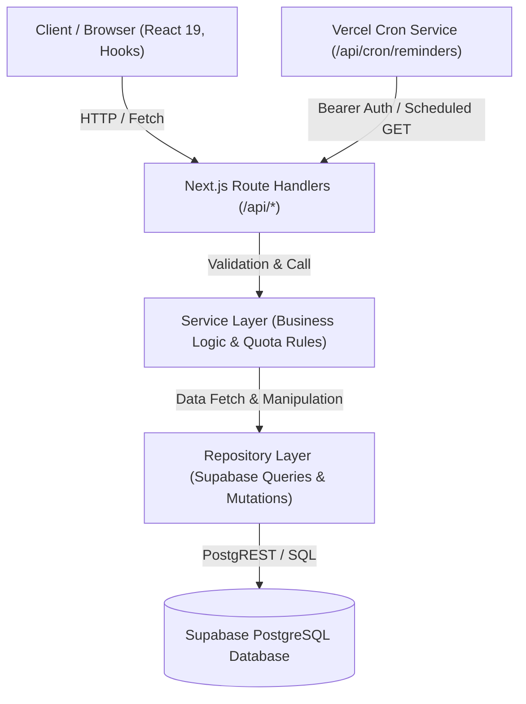
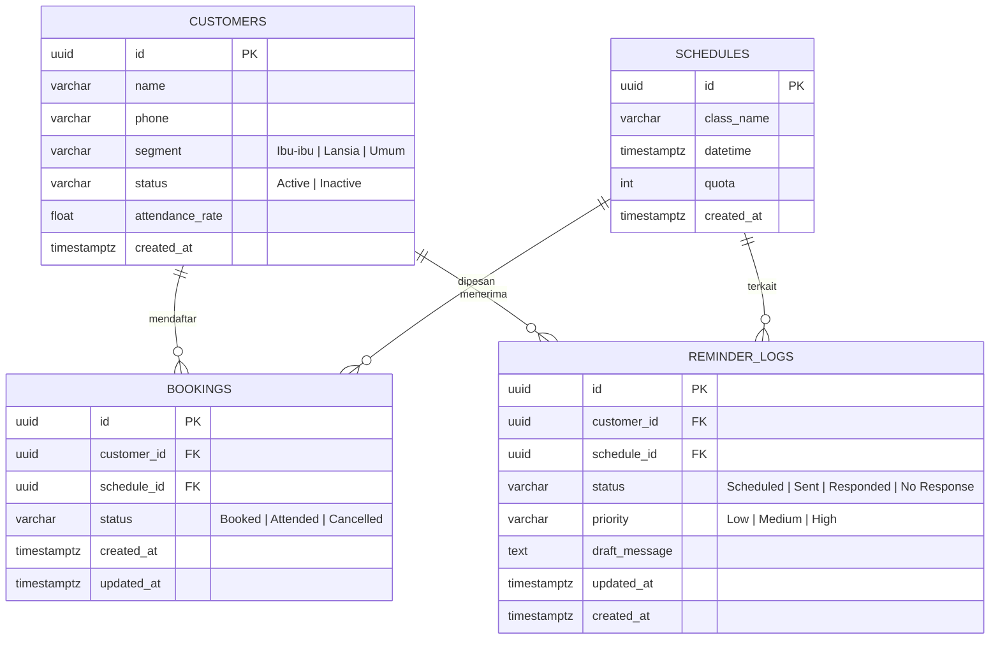

# 🏋️ Gymnasyum App - Smart Operations & WhatsApp Follow-up System

[](https://nextjs.org/)
[](https://react.dev/)
[](https://tailwindcss.com/)
[](https://supabase.com/)
[](https://www.typescriptlang.org/)

**Gymnasyum** adalah aplikasi web operasional dan manajemen pelanggan gym/studio kebugaran berbasis Next.js App Router dan Supabase. Aplikasi ini dirancang untuk mempermudah administrator dalam mengelola data pelanggan, jadwal sesi latihan, reservasi kelas, serta mengotomatisasi penyusunan draf pengingat (reminder) dan komunikasi konfirmasi kehadiran melalui WhatsApp secara cerdas dan personal.

---

## 📌 Daftar Isi
- [Fitur Utama](#-fitur-utama)
- [Arsitektur & Desain Sistem](#-arsitektur--desain-sistem)
- [Tech Stack](#-tech-stack)
- [Struktur Direktori Proyek](#-struktur-direktori-proyek)
- [Skema & Migrasi Database](#-skema--migrasi-database)
- [Panduan Instalasi & Menjalankan Proyek](#-panduan-instalasi--menjalankan-proyek)
- [Konfigurasi Environment Variables](#-konfigurasi-environment-variables)
- [Daftar Endpoint API & Cron](#-daftar-endpoint-api--cron)
- [Otomatisasi Cron Job H-1 Reminder](#-otomatisasi-cron-job-h-1-reminder)
- [Quality Assurance & Pengujian](#-quality-assurance--pengujian)

---

## 🚀 Fitur Utama

### 1. 📊 Operations Overview Dashboard
- Ringkasan statistik operasional *real-time*:
  - **Total Customer**: Jumlah pelanggan aktif dan non-aktif yang terdaftar.
  - **Jadwal Hari Ini**: Jumlah sesi kelas yang berjalan pada hari ini.
  - **Reminder Pending**: Jumlah pengingat berstatus `Scheduled` yang siap dikirimkan.
  - **Pelanggan Prioritas Tinggi (High Risk)**: Deteksi otomatis pelanggan dengan rasio kehadiran di bawah 50% (`attendance_rate < 0.5`) yang membutuhkan perhatian khusus.

### 2. 👥 Manajemen Pelanggan (Customer Management)
- **Segmentasi Pelanggan**: Kategorisasi pelanggan berdasarkan demografi (`Ibu-ibu`, `Lansia`, `Umum`).
- **Pelacakan Kehadiran & Prioritas**: Perhitungan otomatis rasio kehadiran (`attendance_rate`) dan pemetaan tingkat prioritas follow-up (`High`, `Medium`, `Low`).
- **Standardisasi Nomor Kontak**: Format otomatis nomor telepon ke standar internasional WhatsApp (`08...` $\rightarrow$ `628...`).
- **Expandable Class Sub-Row**: Tinjau daftar seluruh kelas yang sedang diikuti oleh masing-masing pelanggan langsung di tabel.

### 3. 📅 Manajemen Jadwal Kelas (Schedule Management)
- Pengaturan sesi kelas (Yoga, Zumba, HIIT, dll.), waktu pelaksanaan, dan batas kuota peserta.
- **Pencegahan Pergeseran Zona Waktu (Timezone Drift)**: Penanganan konversi presisi dari format lokal browser (`datetime-local`) ke standar UTC ISO string di Supabase dan sebaliknya.

### 4. 🎟️ Pendaftaran & Reservasi Kelas (Class Bookings)
- **Validasi Kuota Server-Side**: Pencegahan pendaftaran melebihi kuota (*overbooking*) secara ketat di sisi backend.
- **Pencegahan Reservasi Ganda**: Proteksi terintegrasi pada level database (unique constraint) dan service layer untuk mencegah pelanggan didaftarkan dua kali di sesi yang sama.

### 5. 💬 Sistem Log Pengingat & Follow-up WhatsApp
- **Auto-Generated Message Draft**: Penyusunan draf pesan pengingat personal secara otomatis berdasarkan nama pelanggan, nama kelas, dan jadwal sesi dalam format waktu Indonesia (WIB).
- **One-Click Send to WhatsApp**: Integrasi langsung ke `https://wa.me/` dengan pesan ter-encode.
- **Automated Status Transition**: Status pengingat otomatis diperbarui dari `Scheduled` menjadi `Sent` begitu tombol kirim WhatsApp ditekan.
- **Message Preview & Copy**: Dialog pratinjau pesan lengkap dengan tombol salin cepat ke clipboard.

### 6. ⏰ Otomatisasi Generator Reminder H-1 (Vercel Cron)
- Endpoint otomatis `/api/cron/reminders` yang dieksekusi setiap pergantian hari (tengah malam).
- Menemukan seluruh reservasi kelas untuk esok hari (H-1) dan menyusun draf pengingat secara otomatis.
- **Proteksi Idempotensi**: Mencegah duplikasi draf reminder meskipun endpoint cron dieksekusi berkali-kali.

---

## 🏛️ Arsitektur & Desain Sistem

Aplikasi ini menerapkan **Feature-Based Layered Architecture** untuk menjamin *Separation of Concerns* (SoC), skalabilitas, serta kemudahan pemeliharaan:



- **Repository Layer**: Bertanggung jawab murni untuk komunikasi query/mutasi dengan database Supabase.
- **Service Layer**: Mengenkapsulasi aturan bisnis (validasi kuota, kalkulasi prioritas, pencegahan duplikasi, formulasi pesan).
- **Schema Layer (Zod)**: Memastikan integritas data pada batas input form client maupun payload request API.
- **Hook & Component Layer**: Mengelola state reaktif di sisi UI menggunakan custom hook khusus (`useCustomers`, `useSchedules`, `useBookings`, `useReminders`).

---

## 🛠️ Tech Stack

| Layer | Teknologi |
| :--- | :--- |
| **Framework** | [Next.js 16.4.3](https://nextjs.org/) (App Router, Turbopack) |
| **Library UI** | [React 19.3.0](https://react.dev/), [Tailwind CSS v4](https://tailwindcss.com/) |
| **Komponen UI** | `@base-ui/react`, [Lucide React](https://lucide.dev/), [Sonner Toast](https://sonner.emilkowal.ski/) |
| **Form & Validasi** | [React Hook Form](https://react-hook-form.com/), [Zod](https://zod.dev/) (`@hookform/resolvers`) |
| **Database & Auth** | [Supabase](https://supabase.com/) (`@supabase/supabase-js`, PostgreSQL) |
| **Styling Utility** | `clsx`, `tailwind-merge` |
| **Tanggal & Waktu** | `date-fns` & Native Intl API |
| **Linting & Types** | TypeScript 5, ESLint 9 |

---

## 📁 Struktur Direktori Proyek

```text
gymnasyum-app/
├── public/                     # Aset statis aplikasi
├── src/
│   ├── app/                    # Next.js App Router
│   │   ├── (dashboard)/        # Layout & halaman dashboard
│   │   │   ├── customers/      # Manajemen data customer
│   │   │   ├── reminders/      # Log reminder WhatsApp
│   │   │   ├── schedules/      # Jadwal sesi kelas
│   │   │   ├── layout.tsx      # Dashboard shell (Sidebar, Navbar, Toaster)
│   │   │   └── page.tsx        # Overview operations page
│   │   ├── api/                # API Route Handlers
│   │   │   ├── bookings/       # Endpoint reservasi kelas
│   │   │   ├── cron/reminders/ # Endpoint Vercel Cron generator pengingat H-1
│   │   │   ├── customers/      # CRUD customer & sub-relasi jadwal
│   │   │   ├── reminders/      # CRUD reminder logs & log hari ini
│   │   │   └── schedules/      # CRUD jadwal sesi kelas
│   │   ├── globals.css         # Styling global Tailwind v4
│   │   └── layout.tsx          # Root HTML layout
│   ├── components/
│   │   ├── shared/             # Komponen bersama (Navbar, Sidebar, ErrorBanner)
│   │   └── ui/                 # Komponen antarmuka atomik (Button, Dialog, Select, Table, dll.)
│   ├── features/               # Modul arsitektur berbasis fitur
│   │   ├── bookings/           # Repositories, services, hooks, schemas, komponen booking
│   │   ├── customers/          # Repositories, services, hooks, schemas, komponen customer
│   │   ├── reminders/          # Repositories, services, hooks, schemas, komponen reminder
│   │   └── schedules/          # Repositories, services, hooks, schemas, komponen schedule
│   ├── lib/
│   │   ├── api-response.ts     # Format konsisten apiSuccess & handleApiError
│   │   ├── errors.ts           # Definisi kelas custom error (AppError, ValidationError, dll.)
│   │   ├── supabase.ts         # Inisialisasi Supabase client
│   │   └── utils.ts            # Helper utility cn (clsx + tailwind-merge)
│   └── types/
│       └── database.types.ts   # Definisi tipe entitas database
├── supabase/
│   ├── config.toml             # Konfigurasi Supabase CLI
│   └── migrations/             # Skrip SQL DDL & migrasi skema database
├── vercel.json                 # Konfigurasi Cron job Vercel
├── components.json             # Konfigurasi instalasi komponen UI
├── next.config.ts              # Konfigurasi Next.js (Turbopack, Partial Prefetching)
├── package.json
└── tsconfig.json
```

---

## 🗄️ Skema & Migrasi Database

Skema database berjalan di atas PostgreSQL (Supabase) dengan relasi sebagai berikut:



### File Migrasi (Folder `supabase/migrations/`):
1. `20261026220850_init_gymnasyum_schema.sql`: Membuat tabel dasar `customers`, `schedules`, dan `reminder_logs`.
2. `20261028024533_remove_cancellation_count_from_customers.sql`: Menghapus kolom `cancellation_count` untuk memusatkan perhitungan risiko ke `attendance_rate`.
3. `20261028024808_create_bookings_table.sql`: Membuat tabel relasi `bookings` lengkap dengan `CONSTRAINT unique_customer_schedule UNIQUE(customer_id, schedule_id)` serta foreign key cascade.

---

## ⚙️ Panduan Instalasi & Menjalankan Proyek

### Prasyarat
- [Node.js](https://nodejs.org/) (versi 20 atau lebih baru disarankan)
- [npm](https://www.npmjs.com/) atau manajer paket pilihan (`pnpm` / `yarn`)
- Proyek [Supabase](https://supabase.com/) yang aktif

### Langkah-langkah

1. **Clone repositori dan masuk ke direktori proyek**:
   ```bash
   git clone <URL_REPOSITORI_ANDA>
   cd gymnasyum-app
   ```

2. **Instal seluruh dependensi**:
   ```bash
   npm install
   ```

3. **Konfigurasi Environment Variables**:
   Salin atau buat file `.env.local` pada direktori root proyek:
   ```env
   NEXT_PUBLIC_SUPABASE_URL=https://your-project.supabase.co
   NEXT_PUBLIC_SUPABASE_ANON_KEY=your-anon-key
   CRON_SECRET=your-secure-cron-secret-key
   ```

4. **Jalankan Migrasi Database di Supabase**:
   Buka **SQL Editor** pada dashboard Supabase Anda, lalu eksekusi secara berurutan skrip yang berada di folder `supabase/migrations/`.

5. **Jalankan Development Server**:
   ```bash
   npm run dev
   ```
   Buka peramban di [http://localhost:3000](http://localhost:3000).

6. **Build untuk Production**:
   ```bash
   npm run build
   npm run start
   ```

---

## 📡 Daftar Endpoint API & Cron

Seluruh endpoint API mengembalikan format JSON terstandarisasi:
- Berhasil: `{ "data": ... }`
- Gagal: `{ "error": "Pesan kesalahan", "details": ... }`

| Metode | Endpoint | Keterangan |
| :--- | :--- | :--- |
| **GET** | `/api/customers` | Mengambil seluruh data pelanggan beserta prioritas follow-up |
| **POST** | `/api/customers` | Menambahkan pelanggan baru (dengan validasi Zod) |
| **PUT** | `/api/customers/:id` | Memperbarui data pelanggan |
| **DELETE** | `/api/customers/:id` | Menghapus pelanggan |
| **GET** | `/api/customers/:id/schedules` | Mengambil riwayat kelas yang diikuti pelanggan |
| **GET** | `/api/schedules` | Mengambil seluruh jadwal sesi kelas |
| **POST** | `/api/schedules` | Menambahkan sesi kelas baru |
| **PUT** | `/api/schedules/:id` | Memperbarui jadwal sesi kelas |
| **DELETE** | `/api/schedules/:id` | Menghapus jadwal sesi kelas |
| **POST** | `/api/bookings` | Mendaftarkan pelanggan ke kelas (validasi kuota & duplikasi) |
| **DELETE** | `/api/bookings/:id` | Membatalkan reservasi kelas pelanggan |
| **GET** | `/api/reminders` | Mengambil seluruh log draf pengingat WhatsApp |
| **POST** | `/api/reminders` | Membuat log draf pengingat baru secara manual |
| **PUT** | `/api/reminders/:id` | Memperbarui isi draf atau status pengingat |
| **DELETE** | `/api/reminders/:id` | Menghapus log pengingat |
| **GET** | `/api/reminders/today` | Mengambil pengingat untuk jadwal hari ini |
| **GET** | `/api/cron/reminders` | Trigger otomatis pembuatan draf reminder H-1 (Wajib Bearer `CRON_SECRET`) |

---

## ⏰ Otomatisasi Cron Job H-1 Reminder

Proyek ini telah dikonfigurasi dengan [Vercel Cron Jobs](https://vercel.com/docs/cron-jobs) melalui file `vercel.json`:

```json
{
  "crons": [
    {
      "path": "/api/cron/reminders",
      "schedule": "0 0 * * *"
    }
  ]
}
```

### Mekanisme Kerja:
1. Setiap pukul `00:00 UTC`, Vercel mengirim request `GET` ke `/api/cron/reminders` dengan header `Authorization: Bearer <CRON_SECRET>`.
2. Endpoint memverifikasi `CRON_SECRET`.
3. Mengambil seluruh jadwal kelas untuk rentang waktu esok hari (H-1).
4. Melakukan pengecekan idempotensi terhadap tabel `reminder_logs` agar tidak ada pesan duplikat untuk kombinasi `customer_id` dan `schedule_id` yang sama.
5. Secara otomatis menyusun draf pesan ramah sesuai nama dan jam kelas, lalu menyimpannya ke tabel `reminder_logs` dengan status `Scheduled`.
6. Ketika admin membuka aplikasi di pagi hari, daftar draf pengingat untuk kelas hari esok sudah tersaji rapi dan siap dikirim hanya dengan satu klik!

---

## 🧪 Quality Assurance & Pengujian

Aplikasi ini telah melalui pengujian menyeluruh:
- **TypeScript Static Typing**: Seluruh kode lulus pemeriksaan tipe ketat tanpa error (`npm run build` & `npx tsc --noEmit`).
- **ESLint**: Memenuhi standar `next/core-web-vitals` dan `next/typescript` (`npm run lint`).
- **Data Integrity**: Terlindungi dari *race condition* pendaftaran melebihi kuota dan error duplikasi.
- **UI Responsiveness**: Tampilan responsif di layar desktop maupun perangkat mobile dengan menu navigasi drawer modern.

---

## 📄 Lisensi
Proyek ini dibuat dan dikembangkan sebagai bagian dari submission capstone project di Dicoding Academy. Bebas digunakan untuk keperluan pembelajaran dan pengembangan lebih lanjut.
